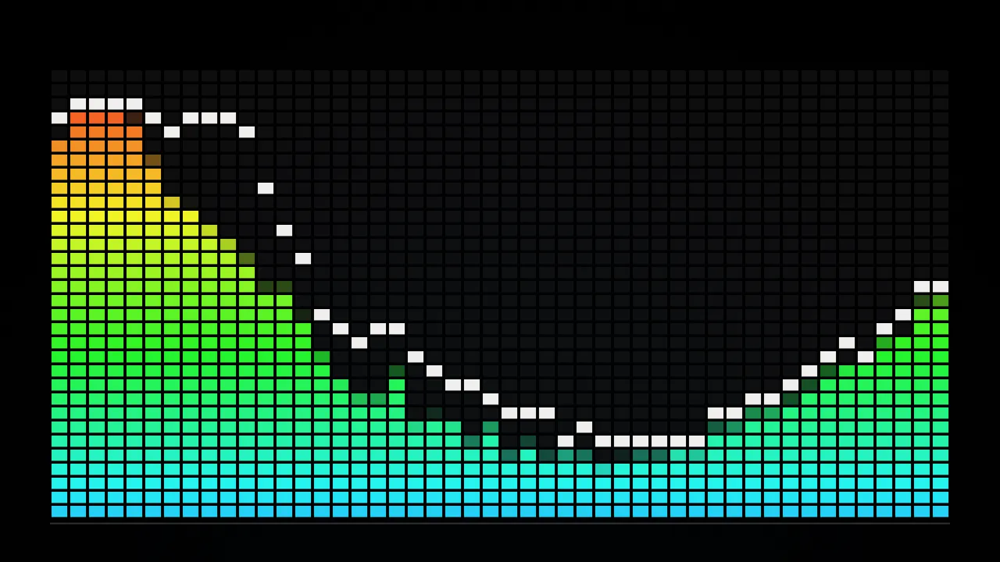
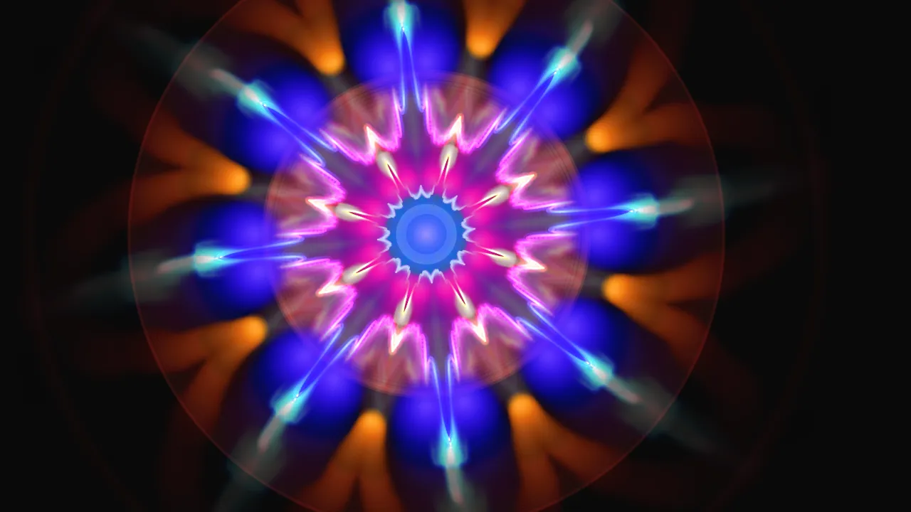
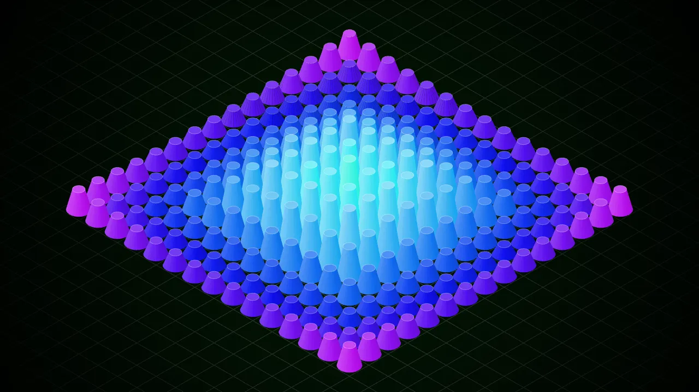
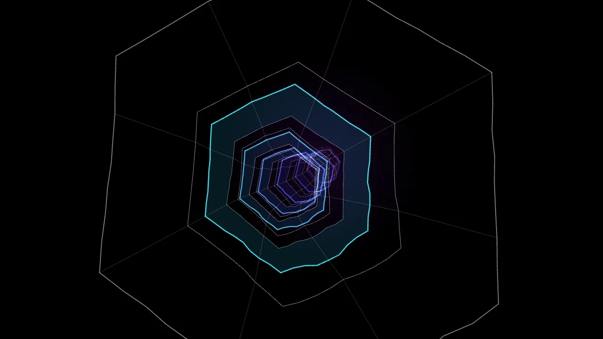
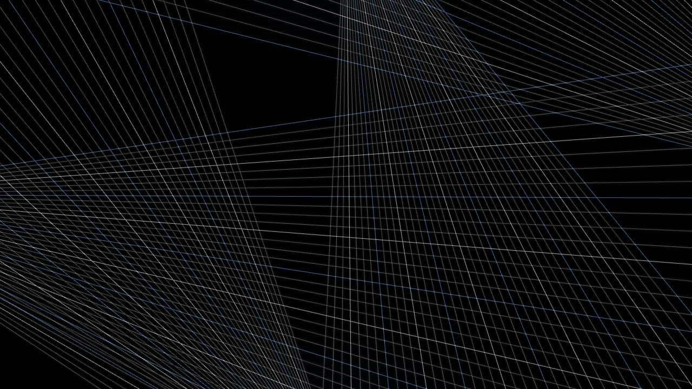
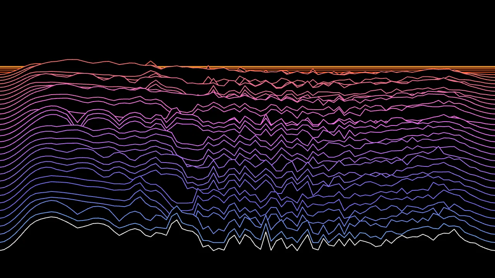
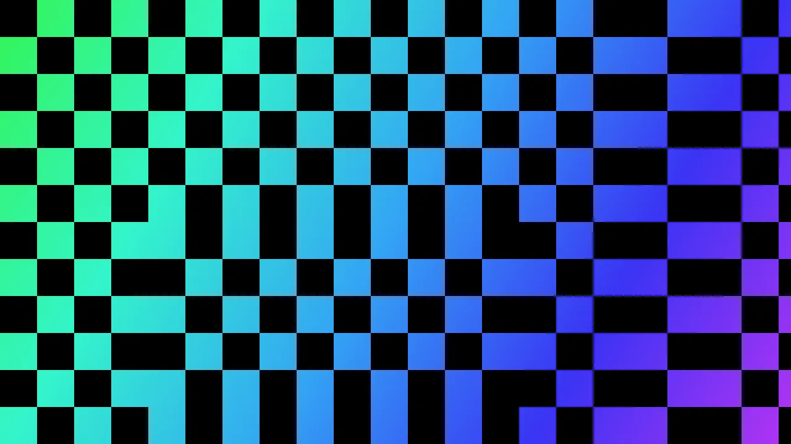

# User guide

## Start

1. Run the app (see the [README](../README.md#getting-started)) and open <http://localhost:5173>. Use `localhost`; browsers block audio capture on plain-HTTP network addresses.
2. Click **Connect audio input** and allow microphone access. The app remembers your last device.
3. Pick your input from the **Audio input** drop-down. The **Input level** meter should move.
4. Click **Start visualizer** (or press **Enter**). The app requests full screen on whichever display the window is on.

Echo cancellation, noise suppression and auto gain are switched off, so your music is analysed as it is.

## Controls

| Key / control | Action                  |
| ------------- | ----------------------- |
| Drop-down     | Switch visual           |
| **←** / **→** | Previous / next visual  |
| **B**         | Toggle blackout         |
| **-** / **+** | Master brightness       |
| **F**         | Toggle full screen      |
| **S**         | Back to input selection |

The overlay and cursor hide after 3 seconds. Move the mouse or press a key to bring them back. The screen is kept awake while the visualizer runs.

## Visuals

The screenshots below are stills from a demo track. They are just a glimpse; the real thing moves with your music.

### EQ Bars

Classic spectrum bars rising and falling.

### Psychedelic

Swirling feedback-style colour that pulses.

### Cubes

A diamond-shaped field of cubes moving with sound.

### Warp Tunnel

Rings of geometry rushing towards you.

### Laser Rig

Sweeping club-style laser beams.

### Ridgeline Waterfall

Stacked spectrum lines scrolling away, one per beat.

### Tile Strobe

A tile grid that flips on the beat.

Tile Strobe has a built-in flash limit (about 3 full-screen flashes per second) to protect photosensitive viewers. It can't be turned off.

## Audio source

| You have                 | Pick                                                        |
| ------------------------ | ----------------------------------------------------------- |
| Music in the room        | Built-in microphone (easiest, lowest quality)               |
| DJ mixer / USB interface | Its audio interface (best; use a booth or record output)    |
| Music on the same laptop | A loopback device (BlackHole on macOS, VB-Cable on Windows) |
| Live band                | USB audio interface fed from the mixer's aux or record out  |

A line-level feed beats a microphone: beat detection is more reliable and room noise stays out of the visuals.

## Live tips

- Test on the real display before doors open.
- Plug in power and turn on Do Not Disturb.
- Use a browser window with no other tabs.
- Keep the input level moving across most of the meter, not pinned at max.
- If the input drops, the stage shows "Audio input lost". Press **S** and pick it again.
